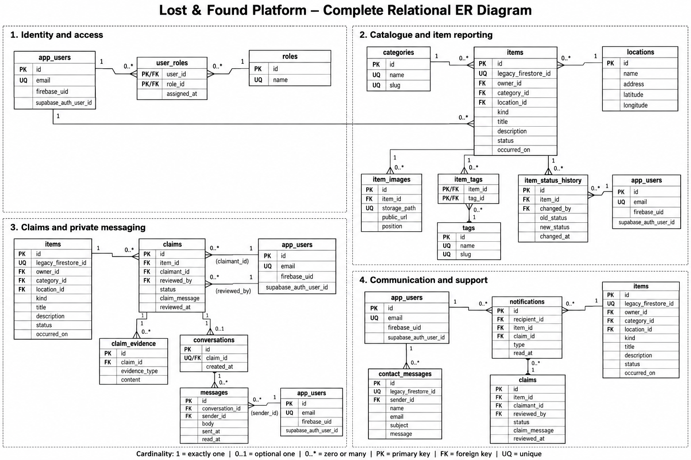

# PostgreSQL schema

[`migrations/001_initial_schema.sql`](migrations/001_initial_schema.sql) defines the Supabase schema, profile sync trigger, row-level security policies for the app's current features, and the public `item-images` Storage bucket. It was applied to the Lost-and-Found Supabase project through the Supabase plugin.

The current app uses `app_users`, `categories`, `locations`, `items`, `item_images`, and `contact_messages`. The schema also includes tables for future claims, messaging, tags, and notifications; those workflows are not implemented in the app yet.

Existing Firebase accounts, items, and image files have not been transferred. The app starts with a fresh Supabase database. A migration of existing Firebase data should be planned separately before relying on that data.
